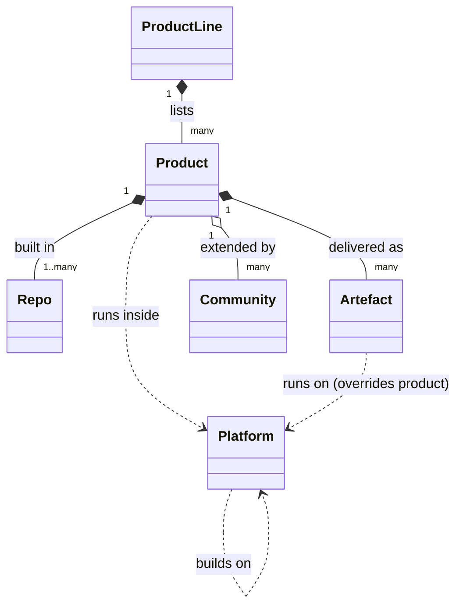

# HQ Product Catalogue

Products are only indirectly referred to, in the context of downloads, releases etc

Add a "Product Catalogue" to the home page.

Each Product is its own home, with the downloads, page views, RFCs, reports etc plus links out to roadmap and design principles.

HQ juggles several views - a product-centric one, a product-line-centric one (e.g. "SignalK Plugins"), an organizational view and a set of horizontal views, such as security that cross all of them.

This could mean much duplication, although in practice some information has a natural home. 

For Downloads and Page Views, this is a marketing horizontal that has an organization wide view, with drill down to products for the details, with products listed in their product lines.

This also needs Product and Product Line properly defined, including how represented in the repos.toml

## Related

- [HQ Seed](hq-seed.md) needs the definitions of product and product line too: its `repos.toml` skeleton is the schema every HQ inherits, so they should be settled before the seed's first release.
- What's there today: `family` (a key of `[families]`) gives each repo its heading on the site, its hq issue area, and in effect its platform (Home Assistant, SignalK, MQTT, Command line, Picoware, Sites, Organisation); `upstream` names the platform it runs inside; `category` marks `major`, `experimental`, `internal` and `meta`. Families are the nearest thing to product lines, but mix in issue areas and platforms. A product line such as "SignalK plugins" or a product with its companions (e.g. a Home Assistant integration and its card) may not map one to one.

### Families today

```toml
ha-integration = { label = "Home Assistant", area = "homeassistant" }
signalk-plugin = { label = "SignalK", area = "signalk" }
mqtt-service = { label = "MQTT", area = "mqtt" }
cli = { label = "Command line", area = "org" }
picoware = { label = "Picoware", area = "org" }
site = { label = "Sites", area = "org" }
meta = { label = "Organisation", area = "org" }
```

`family` does four jobs today, not three: site heading, hq issue area, platform, and the dev sandbox profile
(`hq-private/sandbox/profiles.toml` maps family → profiles). `category` does three: significance (`major`),
lifecycle (`experimental`) and visibility (`internal`), and `family = "meta"` adds a fourth (org site: page views
only, never a product).

## Design (proposed 2026-11-24)

### Terms

- **Product line**: logical grouping of products, that may share common platform, branding and construction, and overlapping user base, and the heading it's listed under. Also the hq issue area.
- **Product**: one thing users install or visit, with one roadmap and one release cadence. The unit of the catalogue, the stats pages and the support/PR processes.
- **Artefact**: how a product is delivered: a package on a registry, a release asset, a website. Its distribution implies its type (`ghcr` is an OCI image; no separate `type`).
- **Platform**: what a product runs on or inside, made by others (today's `upstream`): Home Assistant, SignalK,
  or something as bare as Linux or an ESP32. A product may have more than one (`pico-ble-proxy`: ESP32 and Linux).
  Platforms build on platforms (Home Assistant on Python). The tech stack (Python, Node) is not modelled: it's read
  from the repo (`pyproject.toml`, `package.json`), as hq-seed's modules already do.
- **Repo**: where a product is built. Stays first-class, because nearly everything HQ does (traffic, stars, issues,
  security, CI, sweeps) and every hq-stats snapshot is per repo.



The draft had `Artefact ..> Repo`. Repo hangs off the product instead: artefacts don't need to know their repo
(a product's artefacts are built in its repos), and every per-repo process can find the product from the repo.

### Rules (simplifications on purpose)

1. **A repo belongs to exactly one product.** A product may have several repos (`hq` + `hq-private`, a future
   split). One repo shipping two products isn't supported; if it's ever needed, they become one product with two
   artefacts (as `boat-tech-directory` is: a site and a SignalK plugin).
2. **The product slug defaults to its repo name, and the repo to its slug.** No renames at migration: hq-stats
   snapshots and the `/usage/<id>` page URLs are keyed by repo name, so slug = repo name keeps all history and links.
   Slugs are `[a-z0-9_-]+` (`remote_logger` keeps its underscore), not "single word". A product whose slug must
   differ sets `repos:` explicitly: `homepage` (www.rhizomatics.org.uk) has `repos = [".github"]` (decided
   2026-11-24). Its history is safe because snapshots stay keyed by repo, and as an org site it has no
   `/usage/<id>` page to break.
3. **Line slugs are the existing area labels where there is one** (`homeassistant`, not `hass`; decided
   2026-11-24): issue labels, issue title prefixes (`homeassistant: ...`) and `security_watch` areas keep working
   with no relabelling.
4. **A line and a platform are independent.** Most lines have a default platform (`signalk`), but a line can be
   defined by the near absence of one: Picoware is a line whose products expect little beyond an ESP32 or Linux,
   each product naming its own (decided 2026-11-24). `signalk-cli` goes under `signalk` (as in the draft).
5. **Model only what HQ uses.** No versions and no stack in config (see "Reference data").
6. **Org lines bend the rules.** A line marked `kind: org` holds the org's own things (sites, HQ itself): listed
   under page views only, never counted as products. This replaces `family = "meta"`.

### Product lines

| Slug            | Name           | From                          | Products                                                                  |
| --------------- | -------------- | ----------------------------- | ------------------------------------------------------------------------- |
| `homeassistant` | Home Assistant | ha-integration                | supernotify, autoarm, remote_logger, …, homeassistant-repl                |
| `signalk`       | SignalK        | signalk-plugin, cli, site     | the plugins, signalk-cli, boat-tech-directory                             |
| `picoware`      | Picoware       | picoware                      | pico-ais-reporter (linux), pico-ble-proxy (esp32, linux)                  |
| `mqtt`          | MQTT           | mqtt-service                  | updates2mqtt, anpr2mqtt                                                   |
| `hq`            | HQ             | (none; hq-stats had no family)| hq-stats, hq-seed when created                                            |
| `org`           | Organisation   | meta (`kind: org`)            | homepage (`.github`, www), hq (+ hq-private), agent-plugins               |

- **Dropped from the draft:** `internal` as its own line. It mixed two things: org sites that *are* public (www,
  the HQ site, both with page views) and private repos. Private repos are already skipped by the collector, so
  `internal` is just `public: false` on a product. `hq` and `hq-private` become one product with two repos.
- **Not yet:** `utils`. Add a line when its first product exists (`oci-client`); "Libraries" is the plainer name.
- **`agent-plugins`** is the org-wide catalogue of agent skills, as www.rhizomatics.org.uk is for products, so it
  sits in `org` for now. **Open:** with one entry it's hard to tell whether it stays org-wide or splits by domain
  (a Home Assistant plugin set, a SignalK one). That turns on how agent plugin marketplaces are discovered and
  consumed, which needs looking into before it grows.
- The draft called the HA line "Home Assistant Marketplace": that names a channel, not an audience, and HACS isn't
  the only one (HA analytics, PyPI for homeassistant-repl). The channel belongs on the artefact.

### Per-product fields

Replaces `category` (a list that only ever holds one value) with two independent fields:

- `significance`: `major` or omitted. (Major products get the stricter design and standards checks.)
- `lifecycle`: `active` (default), `experimental` (not shown publicly), `archived` (today's `archived = true`).
- `public: false`: left out of everything public (today's `internal`).

### Format

**Flat products with a `line` reference, not products nested inside lines.** Nesting looks tidy but:
finding a product by slug means walking every line; moving a product between lines is a cut-and-paste of a block;
every consumer (hq-stats, seven site scripts, `collect_github.py`, `sync_sandbox.py`) iterates products, not
lines. Flat is also today's shape (`[repos.x]` with `family =`), so migration is close to a rename.

**Artefacts are a map keyed by artefact name; the distribution defaults to the name.** So the common case stays
terse and reads like today's fields (`artefacts.pypi = "updates2mqtt"`), and a product with two artefacts on the same
distribution names them (`firmware`, `daemon`) and says `distribution =`. No `[[array of tables]]` needed.

**Platform cascades: line → product → artefact.** Most products inherit their line's. An artefact overrides it when
the product is genuinely dual-platform (`pico-ble-proxy`: ESP32 firmware and a Linux daemon). A product's platforms
are the union of its artefacts', which is what the platform review and `security_watch` need.

**Community gets its own flat table**, not nested under products or lines: one table per entry, with `extends =
"<product>"` for a project or `line = "<line>"` for a blog. That's today's `[community.x]` shape, and a line-level
home would lose the product a project's stats page links to.

**Three files, each a flat list of one kind of thing**, so the file says what the tables are and every table
header loses a level (`[supernotify]`, not `[products.supernotify]`):

- `hq.toml`: `org`, `stats`, `lines` (in display order), `platforms`, and HQ's own `labels`, `security_watch`,
  `capabilities`. Changes rarely.
- `products.toml`: one table per product, keyed by slug. Nothing else at top level, so a slug can never collide
  with a section name.
- `community.toml`: one table per community entry. Optional; maintained on its own rhythm (added by hand with the
  maintainer's approval).

With those, nesting stops at one level inside any table (`artefacts.<name>`). The only deeper case is `formerly`,
which is rare (one artefact today).

```toml title="hq.toml (excerpt)"
[org]
name = "Rhizomatics"
github = "rhizomatics"

[lines.homeassistant]
name = "Home Assistant"
platform = "homeassistant"          # default for its products

[lines.picoware]
name = "Picoware"                   # no default: each product or artefact names its own

[lines.org]
name = "Organisation"
kind = "org"

[platforms.homeassistant]
builds_on = ["python"]
```

```toml title="products.toml"
[supernotify]
line = "homeassistant"
significance = "major"
artefacts.homeassistant_marketplace_integration = { asset = "supernotify.zip", domain = "supernotify" }
artefacts.website = { goatcounter = "supernotify" }

[updates2mqtt]
line = "mqtt"
significance = "major"
artefacts.pypi = "updates2mqtt"
artefacts.ghcr = "updates2mqtt"
artefacts.website = { goatcounter = "updates2mqtt" }

[boat-tech-directory]
line = "signalk"
significance = "major"
artefacts.npm = "@rhizomatics/signalk-boat-tech-directory-plugin"
artefacts.website = { goatcounter = "boat-tech-directory" }

# illustrative: pico-ble-proxy has no release assets yet
[pico-ble-proxy]
line = "picoware"
artefacts.firmware = { distribution = "github_release", asset = "pico-ble-proxy-firmware.uf2", platform = "esp32" }
artefacts.daemon = { distribution = "github_release", asset = "bleproxyd.tar.gz", platform = "linux" }

[hq]
line = "org"
repos = ["hq", "hq-private"]        # hq-private is private, so the collector skips it anyway
artefacts.website = { goatcounter = "rhizomatics-hq" }

[homepage]
line = "org"
repos = [".github"]
artefacts.website = { goatcounter = "rhizomatics" }

# the rare case: an artefact with history gets its own table
[appliance_autonotify]
line = "homeassistant"
artefacts.website = { goatcounter = "appliance-autonotify" }

[appliance_autonotify.artefacts.homeassistant_marketplace_integration]
asset = "appliance_autonotify.zip"
domain = "appliance_autonotify"
formerly = { asset = "appliances_autonotify.zip" }
```

```toml title="community.toml"
[supernotify-cards]
repo = "lollox80/supernotify-cards"
extends = "supernotify"
artefacts.homeassistant_marketplace_frontend = { asset = "supernotify-control-card.js" }

[boat-tech-projects]
kind = "blog"
line = "signalk"
title = "Boat Tech Projects"
url = "https://automatedboat.substack.com"
```

Choices in that example, against the draft:

- **`website` with `goatcounter`**, not `github_pages` with `counter_id`: hosting and analytics are separate, and
  a site moving off GitHub Pages shouldn't change its stats config. Only the analytics code is needed today.
- **`domain` on the integration artefact**, not a `homeassistant:` block on the product: HA analytics counts
  installs of an integration, so it belongs with that artefact.
- **`formerly` per artefact** (today's field, kept), not `alt_package`. `formerly.name` on the product keeps
  repo renames.

**Format: TOML (decided 2026-11-24).** Split this way, the TOML above has no deep nesting except the
rare `formerly`. It keeps `collect_github.py` and `sync_sandbox.py` stdlib-only (`tomllib`), and hq-stats users
already write it. YAML would only win if nesting comes back. The new file names also mean old and new can't be
confused.

### Reference data

The draft's `reference.yaml` held three different things:

- **Distributions** are HQ's, in `hq.toml` (decided 2026-11-24): the full set (`pypi`, `npm`, `ghcr`,
  `github_release`, `homeassistant_marketplace_integration`, `website`, ...), used for more than stats (release
  workflows, alignment, the catalogue pages). hq-stats keeps its **own, narrower list: what it can count**. Its job
  is countable things (downloads, installs from HA analytics, page views, stars, traffic), and most map to an HQ
  distribution by the same public name, so the two lists overlap rather than one deriving from the other. That
  keeps hq-stats usable without HQ. Where they overlap the names must match; hq-stats ignores artefacts it can't
  count, and `check-hq` checks every artefact's distribution is in `hq.toml`.
- **Platform versions** are policy (`policies/signalk_versions.md`, the Python policy), not config.
- **Platforms** (the list, and what each builds on: `homeassistant` on `python`) are HQ's: they drive the platform
  review, `security_watch`, sandbox profiles and hq-seed's modules. hq-stats is a helper app and never needs them.
  They go in `hq.toml` as a `platforms` section, static facts only (decided 2026-11-24).

What's in `hq.toml` but not used by hq-stats: `distributions`, `platforms`, `labels`, `security_watch`, `capabilities`. hq-stats
ignores any section it doesn't know.

### Field mapping

| Today (`repos.toml`)            | New                                                        |
| ------------------------------- | ---------------------------------------------------------- |
| `[repos.x]`                     | `products.x` (repo `x`)                                    |
| `family`                        | `line`                                                     |
| `[families]` label / area       | `lines.<slug>.name`; area = line slug                      |
| `family = "meta"`               | a line with `kind: org`                                    |
| `upstream`                      | `platform`: line default, overridable per product and per artefact; picoware artefacts gain `linux` / `esp32` |
| `category = ["major"]`          | `significance: major`                                      |
| `category = ["experimental"]`   | `lifecycle: experimental`                                  |
| `category = ["internal"]`       | `public: false`                                            |
| `archived = true`               | `lifecycle: archived`                                      |
| `pypi` / `npm` / `ghcr`         | `artefacts.pypi` / `.npm` / `.ghcr`                        |
| `hacs_zip` + `ha_domain`        | `artefacts.homeassistant_marketplace_integration.{asset, domain}` (a `.js` asset → `_frontend`) |
| `goatcounter`                   | `artefacts.website.goatcounter`                            |
| `formerly.{hacs_zip,npm,…}`     | `formerly` on the artefact                                 |
| `formerly.name`                 | `formerly.name` on the product                             |
| `[community.x]`                 | `[x]` in `community.toml`; channel fields move under `artefacts`; blogs gain `line` |

## Migration

### hq-stats (has outside users)

1. **One internal model, two readers.** `loadConfig` returns the normalised shape above whichever file it read;
   `fromReposToml` maps today's fields with the table above (`family` → line, `[families]` → lines, `meta` →
   `kind: org`). `collect`, `aggregate` and the Astro pages see only the normalised model. The adapter is small and
   cheap to keep.
2. **Snapshots don't change.** They stay keyed by repo; products are a grouping in `build` (a multi-repo product
   sums its repos). No data migration for anyone.
3. **Config discovery:** `--config` names a directory (or, as now, a `repos.toml`); otherwise the current or
   parent directory. `hq.toml` + `products.toml` (+ `community.toml` if present) are read together; failing those,
   `repos.toml`, which prints a one-line deprecation notice pointing at `hq-stats migrate`. An hq-stats-only user
   needs just `[org]` (and optionally `[stats]`, `[lines]`) in `hq.toml`.
4. **`hq-stats migrate`** writes the three files from `repos.toml` (scripts over agents; also how HQ migrates).
   Families map one-to-one to lines; `upstream` becomes `platform`.
5. **`stats.json`:** add `line` beside `family` (same value) and a top-level `schema: 2`; drop `family` at 1.0.
   Page URLs (`/usage/<id>`) unchanged, since slug = repo name.
6. **Release as 0.3.0**; `repos.toml` support kept at least until 1.0, with the date announced in the CHANGELOG.

### HQ

Order: hq-stats 0.3 first (it owns the published schema), then HQ, then hq-seed ships with the new files only.

- `site/src/lib/hq-config.mjs` loads through hq-stats' `loadConfig` rather than parsing TOML itself, and exports one
  `isProduct` (today duplicated in `build-design.mjs` and `lib/github.mjs`).
- `collect_github.py`, `sync_sandbox.py` (family → platform for profiles), `check-hq`.
- ~20 skills and personas name `repos.toml` or `family`; most only need "the repos in `products.toml`".
  `adoption-report` and `alignment-review` group by family: adoption → line, alignment → platform.
- `registry-check` checks every org repo is in exactly one product's `repos`.
- AGENTS.md "Names used in these docs": add product line and artefact; "areas" become line slugs.

## Tasks

- [x] @human Decide: line slugs (`homeassistant`), Picoware stays a line, platforms list in HQ not hq-stats
- [x] @human Confirm TOML
- [ ] @agent Research how agent plugin marketplaces are discovered and consumed, to settle whether
      `agent-plugins` stays org-wide or splits by domain
- [ ] @agent hq-stats: normalised model, both readers, `migrate`, `schema: 2` in `stats.json`, release 0.3.0
- [ ] @agent hq: switch to `hq.toml` / `products.toml` / `community.toml` via `hq-stats migrate`, then the site scripts, Python scripts and skills
- [ ] @agent hq-seed: skeleton `hq.toml` and empty `products.toml`
- [ ] @pair Product Catalogue pages on the site (the original goal of this project)

## Log

- 2026-11-24: Product line structure drafted; reviewed and reshaped (flat products, repo kept first-class,
  hq-stats compatibility plan).
- 2026-11-24: Decided: `homeassistant` slug; Picoware stays a line (platforms per product: linux, esp32);
  platforms list lives in HQ. `agent-plugins` in `org` for now.
- 2026-11-24: Platform cascades line → product → artefact (dual-platform pico-ble-proxy); community back to its
  own flat table (optionally `community.toml`); artefacts keyed by name, distribution defaulting to it. TOML
  recommended.
- 2026-11-24: Split into `hq.toml`, `products.toml`, `community.toml`, each top level one kind of table.
- 2026-11-24: TOML decided. `.github` becomes product `homepage` (repo override). Distributions defined in
  `hq.toml` (full set) and in hq-stats (what it can count), names matching where they overlap.
